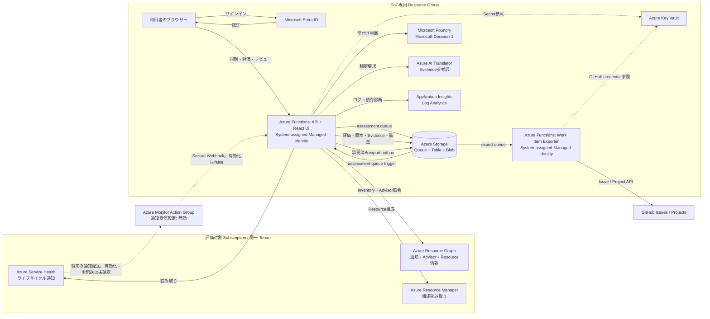
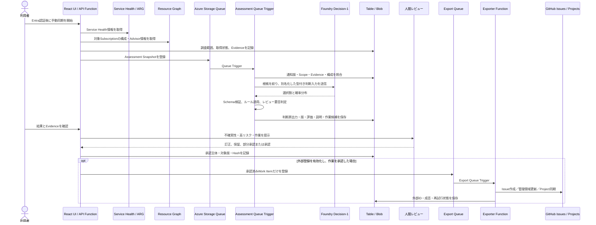

# 現行アーキテクチャとMicrosoft-Decision-1判断ガイド

更新日: 2026-10-29

対象: 登壇スライド・説明準備用。現行コード、Bicep、実装バックログ、Runbookを照合した説明資料。
関連: [システム設計](design.md)、[判断・承認基準](decision-policy.md)、[利用者向け操作ガイド](user-operations-guide.md)、[Spike・テスト計画](spike-and-testing.md)、[実装バックログ](implementation-backlog.md)、[Runbook](runbook.md)

## この資料の読み方

本文は「現行実装」「設計上の方針」「未確認」を区別する。図の実線は配置済みの主経路、点線は有効化可能だが現在の実接続が確認できていない経路・後続処理を表す。Azureやモデルの処理が存在することと、品質・業務上の正しさが実証されたことは同じではない。

## 1. システムの役割

Azureの非推奨、作成停止、サポート終了、廃止などのライフサイクル変更をService Health等から集め、対象Azure構成を読み取り専用で調べ、Workload単位の業務判断と確認・対応案を提示する。評価対象Azureへの変更は行わない。最終判断、作業の確定、GitHubへの登録は人間承認後に行う。

本システムはMicrosoft標準の通知、Advisor recommendation、Resource Graph検索、Azure Policy評価を置き換えない。これらの情報を集約し、自社の業務状況・判断基準・作業フローにつなぐ部分を担う。

## 2. 現行の論理構成

### 配置・認証・データ境界

- API Function Appがレビュー用React画面とAPIを配信する。画面入口はEntra ID認証を要求し、API側もToken・権限を確認する。
- APIとExporterは別Function Appで、それぞれシステム割り当てManaged Identityを使う。APIの対象Subscription権限は読み取りに限定する。
- GitHub ActionsからAzureへの配置はOIDCを用いた手動CD。アプリの実行Identity、GitHub Actions Identity、利用者のEntra ID Identityは別の権限境界。
- Azure Storageは処理Queue、ArpState Table、原本・評価記録を置くBlobを持つ。Hosting用StorageはFunctionのパッケージ配信に使う。
- Key VaultはEntra/GitHub連携秘密の参照先。Application InsightsとLog Analyticsは処理・障害診断を記録する。通常ログにモデル本文・実Resource IDを出さない。
- Bicep上、PoC Function、Storage、Key Vault、TranslatorのPublic Network Accessは有効。閉域Private Endpoint構成ではない。
- GitHubへの登録、日次同期、Service Health通知受付、障害Alertは構成で制御される。実際の通知配送とGitHub実Projectへの登録は未確認で、PoC設定上無効の経路がある。

## 3. 処理・データの流れ

1. **入口**: 現行の主な操作は認証済み画面からの手動同期。日次同期は設定で制御され、Secure Webhookによる通知受付は別経路として用意されているが、本番同様の通知配送は未確認。
2. **取得**: Service Healthの通知とResource Graphのインベントリ等を取得元別に扱う。Subscription／ページ／データ源の欠落は「該当なし」と混ぜず、取得範囲・完全性を保存する。
3. **候補発見**: 明示対象は根拠付きで記録する。Resource type、SKU、Region等の一致は承認済みプロファイルに基づく候補。Advisorに出ないことのみで対象外にしない。データプレーン探索はPoC外。
4. **集約**: イベント版×Workload単位に評価し、個々のResource行と確度・理由・不足属性・Evidenceを保持する。
5. **判断**: 十分に完全な「該当リソースなし」等、定型ケースでは評価レビューを省略できる。その他はモデル結果・決定的ルールを適用し、必要に応じ人間レビューへ送る。
6. **出力**: 説明生成モデルが未設定または失敗した場合、モデル生成説明を表示せず、監査状態に未設定・失敗を記録する。通知種別に基づく一般的影響説明と安全な確認作業案は説明LLMの代替応答として扱わない。Work Itemは承認前に確定・外部登録しない。
7. **登録**: GitHub出力は別ExporterとQueueに分離する。承認Hash、対象版、重複照合、外部IDを確認し、登録の成否不明を成功扱いしない。

## 4. リソース確度と業務影響は別の問い

| 軸 | 問い | 主な値 | 例 |
|---|---|---|---|
| リソース確度 | このAzure Resourceが告知の適用対象か | Confirmed / Probable / Possible / Verification Required / Not Impacted / Unknown | SKUが一致したが明示対象でない場合はProbable等 |
| 業務影響 | 対応しない場合、または対応中・対応後に業務へ何が起こるか | Low / Medium / High / Critical / 未確定 | 廃止で依存機能がなくなる、移行停止がサービス提供時間に重なる等 |

影響が確認できても移行を必須にするとは限らない。不確実性が高い時は調査・確認をRecommendedとし、移行のRequired化と本番変更は人間が判断する。

## 5. Microsoft-Decision-1の役割

Decision-1はこのシステムで**型付きの判断候補を返すモデル**であり、自由文の根拠説明を作る役割ではない。入力Stateと質問ごとに適した型を受け取り、選択肢・Score・Noulを返す。影響度は順序尺度のScore、プロジェクト化要否はNoul、それ以外はChoiceを使う。

| Decision key | 判断対象 | 選択肢 |
|---|---|---|
| `impactIfUnaddressed` | 対応しない場合の業務影響 | Low / Medium / High / Critical / Unknown |
| `impactDuringAndAfterChange` | 対応中・対応後の業務影響 | Low / Medium / High / Critical / Unknown |
| `priority` | 調査・対応プログラムの着手優先度 | P1 / P2 / P3 / P4 / Unknown |
| `startWindow` | 最初の作業を始める時期 | Immediate / Within 30 days / Within 90 days / Within 180 days / Later / No action / Unknown |
| `complexity` | 構成変更・代替・必要工程の難易度 | Low / Medium / High / Unknown |
| `projectRequired` | 複数チーム・段階工程等を踏まえたプロジェクト化要否 | Noul（Yesの確率）からYes / No / Unknownへ変換 |

未対応時と対応時・対応後は別々に選択する。期限の近さだけを理由に未対応影響を上げない。移行方法が不明なら対応中・対応後影響や難易度をUnknownにできる。`No action`は根拠ある「対応不要」の候補で、空欄や確認未了の意味ではない。

### Decision-1が現在受け取る入力

実装の`groundedInput`はWorkload単位のStateを作り、実IDやチーム名を別名に置き換える。現在モデルへ渡す要素は概ね以下。

- 通知版、タイトル、本文、ライフサイクル種別、マイルストーン
- Evidenceの出典情報、対象参照、事実記述
- Resourceの別名、Resource Type、SKU、Region、Environment、分類・分類理由、不足属性、Verification Required、Evidence ID
- Workload別名、確認を要する情報、評価日
- 説明段階ではDecision-1の選択結果も追加する

任意のARM `properties`全体、実Resource ID、実Workload ID、Ownerチーム名はそのまま送らず、型付き属性と別名を使用する。1 Workloadごとに入力を制限し、120 KBを超えるStateは拒否する。

**現行統合の重要な限界**: Decision-1へOwner・Critical workloadの確定値、CMDB品質、RTO/RPO、サービス提供時間、変更禁止期間、移行工程の日数、承認済み代替案、費用情報等を完全な業務コンテキストとして渡す統合はまだ整っていない。未設定情報は人間確認へ残す。したがって、モデル判断が企業固有の業務事情を網羅的に理解している、または正確な実日程を計算しているとは説明しない。

影響度の型付き判断に加えて、現在はライフサイクル種別に基づく一般的な影響説明を決定的テンプレートで付与する。公式Evidenceを参照し、通知適用条件を明示し、業務処理名・停止時間など未取得の固有情報は断定しない。これはWorkload固有の影響評価ではない。将来の個別影響には、Azure Resourceと業務システム／処理の依存対応を人が確認・承認したデータとして登録し、Evidenceと版を評価へ保存する必要がある。現行`businessContextProfiles`はSyntheticDemo用であり、その依存マッピングには使えない。

### 応答の検証と解釈

- `model`、回答キー、質問の型、選択肢・Scoreの確率分布、Noulの範囲をSchema検証する。Scoreは確率加重平均との整合性も確認する。
- 影響ScoreをLow=0、Medium=1、High=2、Critical=3の順序尺度で扱い、値と分布を監査保存する。最大確率80%以上かつ次点との差が20ポイント以上の場合のみ影響区分へ変換し、それ以外は未確定として人間確認に残す。Scoreは校正済み確率や絶対的な業務影響値ではない。
- NoulはYes確率80%以上でYes、20%以下でNo、それ以外はUnknownとし、判定確率も監査保存する。
- 各確率は0〜1、合計は1からの差が0.01以内であることを検証する。
- 選択値が`Unknown`なら該当値はnullへ変換する。必須判断の一つでもnullならDecision状態は`Abstained`、全て値がある場合だけ`Proposed`。
- 確率分布はモデルの自己申告した候補分布であり、正解確率・校正済み信頼度・承認ではない。モデル版、Prompt Version、Rule Version、原応答、入力／結果Hashを追跡する。
- Decision-1はチーム割当、説明文章、Evidenceの真偽、作業承認、Resource IDの新規作成を担当しない。Owner Teamはこの応答ではnull。
- 接続失敗・無効応答・未設定はUnavailable／Abstained相当として記録し、成功やNo actionに偽装しない。互換モデルへ自動切替しない。

## 6. ルール、説明モデル、人間の責任分担

| 主体 | 受け持つ処理 | 確定しないこと |
|---|---|---|
| Azure標準サービス | 通知、Advisor Recommendation、Azure Resourceとその属性 | 社内業務優先度、担当、移行計画 |
| 決定的ルール | 期限差・工程余裕、優先度下限、取得不完全時の引上げ、低確率・僅差、Critical等のレビュー理由 | 業務上の最終許容、代替案採用 |
| Microsoft-Decision-1 | 影響度のScore、プロジェクト化要否のNoul、その他の型付き選択肢 | 自由文説明、事実・期限の創作、承認 |
| 生成説明LLM | 判断根拠・増減要因・不足情報・条件・作業候補を指定Schemaで整理 | 公式事実の創作、IDや期限の確定、承認・本番変更 |
| 検証器 | Evidence参照、ID、日付、Workload関係、依存DAG、承認版Hash、Schemaを検査 | 検証済みであることだけから作業妥当性を保証 |
| 人間 | 業務事実の補完、影響・方針・作業・担当・例外の最終判断、外部登録承認 | — |

優先度計算の設計は、ルールが期限と残工程から最低優先度を計算し、期限不明・取得不完全・未解決の期限接近等で保守的に引き上げる。Decision候補より低い優先度へは下げず、重要な不確実性や確率の低さ・候補僅差はレビュー理由とする。Critical workloadや作業承認も人間確認を維持する。

**現行実装上の注意**: 評価フローの呼出箇所では、Decision後のルールに`applicableDeadline: null`、`remainingCalendarDays: null`、`criticalWorkload: false`、`unresolvedImpact: true`を渡している。これにより日付ベース計画余裕やCriticalフラグによるルール計算は現状の評価では確定できず、期限未確定理由と保守的なP2下限・人間確認が適用される。スライドでは「ルール機能の実装」と「現データからの適用実績」を混同しない。

説明LLMは入力データを非信頼情報として扱う指示と厳密JSON Schemaを受け取る。現在、本番接続と意味的Grounding品質は未確認である。未設定・失敗時は固定テンプレートで説明を補完せず、実行記録のmodel invocation状態に記録する。このため「AIが説明を生成した」と一律に紹介せず、実行状態を確認する。

## 7. Decision-1のPoC検証状況

- Microsoft-Decision-1 version 1をFoundryに配置し、API Managed Identityから推論APIを呼び出す経路を確認済み。
- 実Service Healthデータに対する1評価の応答を確認した。結果はAbstainedで、不確実性レビューを維持した。これは一例であり判断品質の証明ではない。
- 合成3ケースを各3回、合計9回実行し、選択肢・確率契約は9/9で検証を通過。全9回で少なくとも1項目がUnknownとなった。
- 3回反復は同一条件の安定性観測で、独立事例3件の精度評価ではない。Basic Load Balancerの未対応時影響はCriticalが1/3、Highが2/3で揺れが観測された。
- Precision／Recall、影響度・優先度の人間判断との一致、閾値校正、Workload業務情報の効果は未評価。36独立シナリオ×3回の品質評価は未完了。
- Decision-1単体の結果と、アプリのルール適用後の結果を別に扱う。合成評価の期限は合成値であり公式Retirement日ではない。

## 8. 現行と未確認の一覧

| 領域 | 現在言えること | 未確認・未完了 |
|---|---|---|
| 配置 | 2026-10-29時点のmain API／Exporterを専用Azure RGに配置 | 最新CommitでのEntra認証済み画面UAT |
| 入力 | Service Health実通知7件、Resource Graph構成2件を過去に取得 | 最新データの全ページ精度、Advisor正の相関・明示対象 |
| Decision-1 | API MIから実呼出し。合成9回は出力契約合格 | 判断精度、業務判断一致、確率校正 |
| 説明 | Schema、Grounding検証、固定フォールバックを実装 | 説明LLMの実接続と意味的Grounding評価 |
| GitHub | 承認後のIssue／Project連携コードと分離Exporterを実装 | 個人PoC Projectの実権限・登録・更新UAT |
| 通知 | Secure Webhook／Action Groupの構成がある | Action Group実配送、Webhook実受信。設定は無効 |
| 障害運用 | Poison queueと手動照合／再投入Runbookあり | 実Poison再処理と重複なし復旧 |

## 9. 登壇スライドで伝える要点

1. Microsoft標準サービスから「何が告知され、Azure上に何があるか」を得る。
2. 確度分類と業務影響は別に評価する。リソースの存在だけで業務影響は決まらない。
3. Decision-1は業務影響など6項目の型付き候補を返す。説明文生成、期限ルール、Evidence検査、人間承認とは役割が違う。
4. UnknownやAbstainedを隠さず、必要な調査を作業案として示す。未確認は安全側の完了扱いにしない。
5. 実データ7通知・モデル応答1件は経路確認。PoC判断品質の合格を意味しない。
6. システムは評価対象に書き込まず、人間承認を経た作業だけを外部登録する設計。

### 発表時に避ける断定

- 「Decision-1がAzure全体をスキャンする」— Resource Graph等で取得した入力を判断に用いる。
- 「Decision-1が影響Resource IDや公式期限を見つける」— ID・期限は通知／Azure情報の取得と検証の対象。
- 「モデル確率が正解率」— 校正済み精度ではない。
- 「Unknownは影響なし」— 現時点で分類できない、または不明情報がある状態。
- 「PoCで全通知を検知できる」「ゼロ件なら影響なし」— 対象Scope・取得完全性・情報源依存がある。
- 「AIが自動移行する」「P1なら即時本番変更」— 本システムは対象変更を行わず、P1は判断・着手優先度。
- 「実通知・モデル評価・外部登録まで本番品質確認済み」— 限られた接続確認と品質評価を区別する。

## 10. スライド作成前に更新する運用

スライド化時は、デプロイ日・Commit、サービス設定の有効／無効、モデルdeploymentと版、最新の通知件数、取得Scope、Decision／Explanation invocation statusをRunbookと実環境から再確認する。実Resource ID、通知原文、Tenant／Subscription識別子、Token、個人・機密情報はスライドへ転記しない。デモ画面を使う場合は説明者が事前サインインし、実データを表示してよい範囲を確認する。
