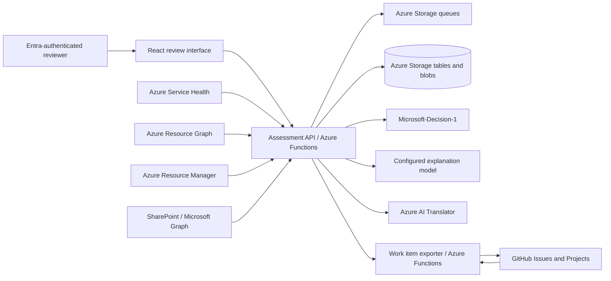

# Architecture and decision model

This document describes the implementation in this repository. Deployment-specific values are supplied separately and must not be copied into source control.

## Components

The React application is built with the assessment API and served from the API Function App. The exporter is a separate Function App. Both use system-assigned Managed Identities for Azure service access. GitHub Actions uses OIDC for the deployment identity. User authentication, application identity, and deployment identity are separate security principals.

The base Bicep deployment provisions two Function Apps, separate hosting and data storage accounts, queues, a state table, a private blob container, Key Vault, Application Insights, Log Analytics, and Translator. Azure Functions and supporting endpoints use public network access in the base deployment; private endpoints and network isolation are not configured by default.

## Request and assessment flow

1. A user with an assigned Entra application role opens the review interface. Easy Auth and API token/role validation protect access.
2. An authorized operator requests synchronization. Service Health notices, Resource Graph inventory, Advisor data, and configured SharePoint sources are fetched through separate adapters.
3. The system records source, time, scope, completeness, failures, source version, and evidence. Partial or failed discovery is not treated as an empty, unaffected result.
4. The assessment service selects candidate resources using explicit notice targets and enabled resource applicability profiles. Resource type, SKU, region, kind, and other applicable attributes are considered where the profile defines them. Unknown attributes remain visible for review.
5. The service builds one assessment per lifecycle event and workload. It grounds model inputs in the notice, resource facts, and confirmed evidence, then validates model output and applies deterministic rules.
6. The UI presents impact, evidence, uncertainty, candidate resources, and work proposals. A human can correct and review a specific immutable assessment version.
7. An approved work item can be sent to a separately queued exporter. The exporter reconciles existing GitHub issues and Project items before creating or updating them. Issue creation and Project item updates are separate steps and may partially succeed.

Azure synchronization is read-only with respect to assessed subscriptions. It does not change Azure resources, resource tags, permissions, or workloads. Provisioning of the Planner's own infrastructure is a separate reviewed Bicep deployment.

## Decision responsibilities

| Component | Responsibility | Does not decide |
|---|---|---|
| Azure services | Publish notices, recommendations, resource inventory, and control-plane attributes | Business criticality, owner, or migration plan |
| Applicability profiles | Identify possible resource candidates from notice-specific conditions | Runtime usage or business impact by themselves |
| Microsoft-Decision-1 | Return typed choices and score distributions for impact, priority, timing, complexity, and project need | Evidence truth, team assignment, approval, or Azure changes |
| Deterministic rules | Apply deadlines, priority floors, completeness constraints, and review requirements | Business acceptance or final policy exceptions |
| Explanation model | Produce evidence-bounded explanations and work proposals when configured | Official dates, resource IDs, approvals, or unsupported facts |
| Validators | Check schema, evidence references, IDs, dates, workload linkage, dependency graph, and approval hash | Guarantee that an otherwise valid work proposal is appropriate |
| Human reviewer | Confirm business facts, applicability, impact, work, ownership, exceptions, and exports | — |

Decision-1 score distributions are ordinal model outputs. The UI shows the highest-scored impact category or categories; ties may result in multiple categories being displayed. These scores are not calibrated probabilities of correctness. A score, `Unknown`, or `Abstained` result cannot approve work or establish that a resource is unaffected.

The two impact axes are distinct:

- **Risk if unaddressed**: potential consequence if an applicable capability is retired while still in use.
- **Impact during and after response**: potential effects of upgrading, migrating, switching, or other response work.

Where business-specific dependencies are unavailable, the UI may show a general lifecycle-based impact narrative. It is conditional and does not identify a particular business process or downtime. Confirmed SharePoint facts can add workload evidence, but a document statement is not proof of current runtime use. Fact proposals require a Governance user to confirm the statement and explicitly link dependencies to resources.

## Evidence and model input

Each assessment preserves source and observation metadata, evidence IDs, model invocation status, model and prompt versions, input/result hashes, and assessment version. Resource IDs and team names are aliased in model input. The system does not provide the model the full ARM `properties` object. Text from Microsoft or internal documents is untrusted input; embedded instructions are not executable instructions.

Explanation behavior has two separate paths. The explanation deployment is configurable and its invocation state is recorded per assessment. Deterministic general impact narratives are not a substitute for a failed or unavailable explanation-model invocation. Microsoft facts, evidence, and official URLs are kept separate from generated explanations. Date parsing does not turn a migration deadline or deprecation start date into a retirement date.

## SharePoint document flow

The API reads configured SharePoint folders using Microsoft Graph and a Managed Identity. Files are listed and stored as immutable snapshots; supported extraction formats are DOCX and XLSX, subject to configured file, page, batch, and text limits. Fact extraction produces candidates with source location and content hash. A Governance reviewer can correct, confirm, or exclude each candidate. Confirmed facts and explicitly reviewed dependency links are versioned and scoped to a workload. Only confirmed live-source facts are eligible for ordinary assessments; isolated synthetic-source facts remain segregated.

The Graph `Sites.Selected` application permission and site-level `read` grant are both required. A configured folder does not narrow the Graph grant: the site grant permits access at site scope. Use a dedicated site when that access boundary is too broad.

## Environment controls

Synchronization, notification ingestion, SharePoint synchronization, SharePoint extraction, live SharePoint sources, GitHub export, Project progress synchronization, and isolated assessment flows have independent settings. The Bicep parameter file defaults these functions to disabled unless deployment variables explicitly enable them. In the currently configured deployment, test mode is disabled; live SharePoint synchronization and fact extraction and GitHub export are enabled; Project progress synchronization is disabled. These values are deployment-specific and may differ in other installations.

## Known boundaries

- Resource Graph and control-plane inspection cannot establish runtime use in all cases. Data-plane, guest OS, application-code, and connection-string discovery are not performed.
- Applicability profiles cover configured resource types and conditions. A missing profile results in review, not a global claim of no impact.
- Business ownership, criticality, RTO/RPO, change windows, approved migration options, and task durations require explicit business data or human confirmation.
- SharePoint source configuration currently targets a folder and its descendants. Source discovery from arbitrary URLs is not performed. Multiple folders and more advanced source governance are not a unified search capability.
- GitHub export depends on configured token credentials and permissions. The adapter currently reads a GitHub token from Key Vault; a GitHub App installation-token flow is not implemented.
- Notification delivery, export, and progress synchronization are independently enabled. Their presence in code or infrastructure does not mean every destination or role is configured in every deployment.
