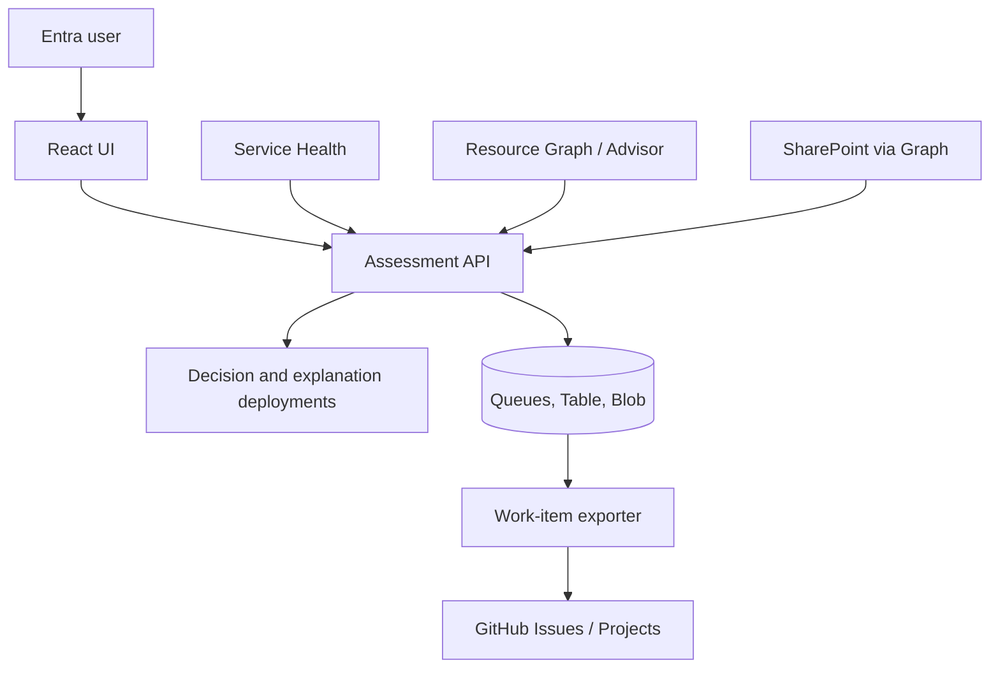

# System design

Azure Retirement Planner organizes lifecycle notices, Azure inventory, approved business facts, and work-planning decisions into evidence-linked assessments. It supports human review and optional work-item export. It does not execute migrations, remediate resources, or provide incident response.

This describes the implementation in the repository. Environment-specific identities, scopes, model endpoints, network boundaries, and external destinations are supplied at deployment time.

## Goals and boundaries

### Goals

- Collect lifecycle information from Microsoft Azure sources and distinguish complete, partial, and failed discovery.
- Identify candidate Azure resources without treating inventory as proof of actual use.
- Record risk if unaddressed separately from impact during and after a response.
- Preserve official evidence, configured business facts, model results, human corrections, and approval history.
- Present uncertainty and concrete confirmation tasks rather than inventing missing dates, owners, impacts, or plans.
- Export only work selected and approved for a specific assessment version.

### Non-goals

- Repair, migrate, tag, delete, or otherwise modify assessed Azure resources.
- Inspect guest operating systems, application code, credentials, connection strings, or data planes.
- Replace Azure Service Health, Advisor, Resource Graph, Azure Policy, CMDB, ServiceNow, or organization change management.
- Automatically prove business criticality, runtime usage, ownership, approved alternatives, or migration completion.
- Automatically close internal or external work from a state change alone.

## Runtime architecture

The monorepo contains the assessment API and UI, a separate work-item exporter, shared contracts/domain/adapters, and Bicep deployment templates.

The API Function App serves the React build. API and exporter use separate system-assigned Managed Identities. GitHub Actions uses a separate OIDC deployment identity. The base Bicep config enables public network access for Functions and supporting services; private endpoints and network isolation require additional configuration.

## Identity and authorization

User tokens are validated for tenant, audience, issuer, user/application type, and role. Roles in the API are `Reader`, `Reviewer`, `Operator`, `Governance`, and `NotificationSender`; the last is application-only. The API repeats authorization checks even when an action is hidden by the UI.

The API's Managed Identity reads configured Azure scopes and invokes configured services. The exporter identity accesses only the data and secrets needed for export. The assessed Azure scope receives read access, not Contributor. GitHub Actions deployment permissions are limited to the Planner's own resource group; privileged bootstrap role assignments use separate templates and authorization.

## Data flow

1. The user requests synchronization or review through the authenticated interface.
2. Independent adapters collect Service Health notices, Resource Graph/Advisor information, configured SharePoint folder contents, and relevant control-plane attributes.
3. Raw records and immutable versions are stored in Blob; indexes, status, outbox, and current-version pointers are stored in Azure Tables; asynchronous work uses Storage Queues.
4. Discovery records source, query, scope, timestamp, completeness, and safe failure classification. Failed retrieval is not converted into an empty result.
5. The assessment service groups a lifecycle event by workload, matches configured resource profiles, builds evidence-grounded model input, validates typed decisions, and applies deterministic rules.
6. The review interface shows resource candidates, two impact axes, priority, evidence links, model invocation status, missing facts, and work proposals.
7. A reviewer may correct an assessment or approve selected work against its current version/hash. The exporter separately reconciles GitHub Issues and Project items.

## Assessment and decision contract

The lifecycle assessment is scoped to an event version and a workload. It contains source metadata, evidence, resource candidates, discovery results, decision and explanation invocations, rule results, work items, corrections, review state, and package hash.

Microsoft-Decision-1 proposes typed values for unaddressed impact, response impact, priority, start window, complexity, and project need. Score distributions are retained as model outputs, not calibrated confidence. Deterministic rules enforce policy floors and completeness constraints. An `Unknown`, `Abstained`, low score, tied leading category, or material disagreement can require review; it cannot authorize a change.

Date categories are separate: deprecation, creation stop, end of support, retirement, and response deadlines. The implementation only sets retirement dates from supported official signals. Missing or conflicting dates remain unresolved.

Explanation generation is separately configured. General lifecycle impact narratives are deterministic and not a substitute for an unavailable explanation model. Claim/evidence links are checked before persistence. Unsupported assertions, fabricated IDs, unreferenced citations, and unsupported plan dates are not accepted as confirmed facts.

## Azure resource discovery

Candidate resources come from official explicit targets and versioned applicability profiles. The current profile registry includes Basic Load Balancer, Storage GPv1, Application Insights URL ping tests, and classic Foundry Agent Service. A profile selects the relevant resource type and conditions but does not establish runtime use. Resource types without a matching notice profile are not treated as unaffected.

Resource classifications distinguish `Confirmed`, `Probable`, `Possible`, `Verification Required`, `Not Impacted`, and `Unknown`. They are separate from business impact. Scope completeness and retrieval failures remain visible. Control-plane relationships such as associated storage do not by themselves prove that an application uses the resource.

## SharePoint document integration

SharePoint Sources identify a tenant, site, document library, folder item, workload, and source class. The API reads files under configured folders through Microsoft Graph; it does not crawl arbitrary links. DOCX and XLSX text is extracted subject to size and batch limits. Original files and snapshots are immutable.

Model extraction creates fact candidates with source location and hashes. Governance users can edit, confirm, or exclude candidates. Confirmed live-source facts can be included as workload evidence. A reviewer must explicitly link related facts and Azure resources; the API checks workload, resource membership, evidence, version, and dependency graph consistency. Synthetic-source facts stay separate from live assessment inputs.

Microsoft Graph access requires application `Sites.Selected` and a site-level `read` grant for the API identity. This grant is site-scoped, not folder-scoped. The application folder selection does not reduce the Graph permission boundary.

## Review, export, and versioning

Corrections create immutable assessment versions with actor, reason, time, and evidence. Material changes invalidate affected approvals. No-action status removes an assessment from the ordinary list but retains its notice, evidence, and history.

The review approval applies to selected work items in one assessment version and hash; it is not authorization to alter assessed Azure. GitHub export is separately feature-gated. Parent/phase/work-item issue hierarchy and Project item updates use idempotency and reconciliation. Partial failure is represented by its stage and retried without assuming success.

## Environment settings

Deployment parameters control synchronization, ingestion, model-call limits, SharePoint live sources and extraction, work-item export, progress synchronization, and isolated assessments. The Bicep parameter file uses safe disabled defaults when variables are absent. The maintained deployment currently enables live SharePoint synchronization and fact extraction and GitHub export, disables test mode and Project progress synchronization, and uses a configured GPT-6 Luna explanation deployment. These settings are specific to the maintained environment and must not be copied as universal defaults.

## Privacy and operations

Do not commit live resource identifiers, notification payloads, SharePoint IDs, tokens, personal data, model prompts, or model outputs. Logs contain safe error categories, status, stage, and correlation metadata rather than raw payloads. Operational storage, retention, deletion, and legal hold requirements must be configured by the deploying organization.

The base deployment does not provide universal compliance, private networking, disaster recovery, or calibrated AI accuracy. Organizations must review those requirements, current provider support, region availability, quotas, prices, and data-processing terms before deployment.
