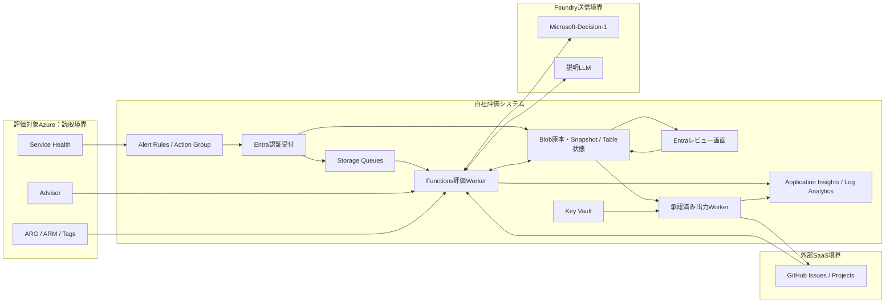
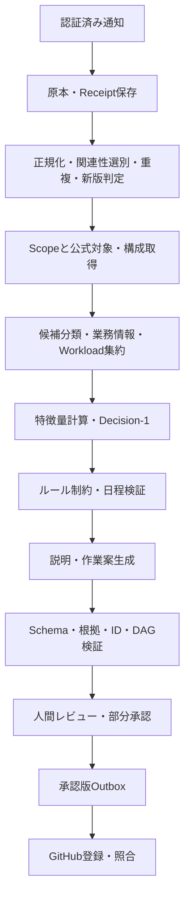
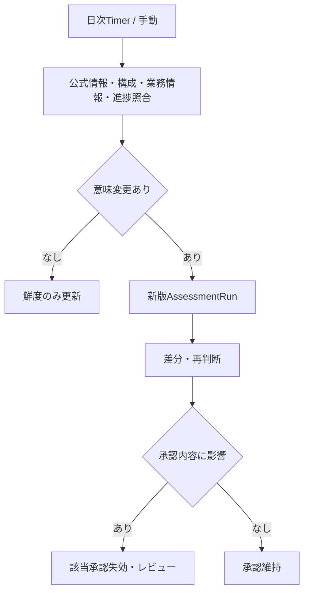
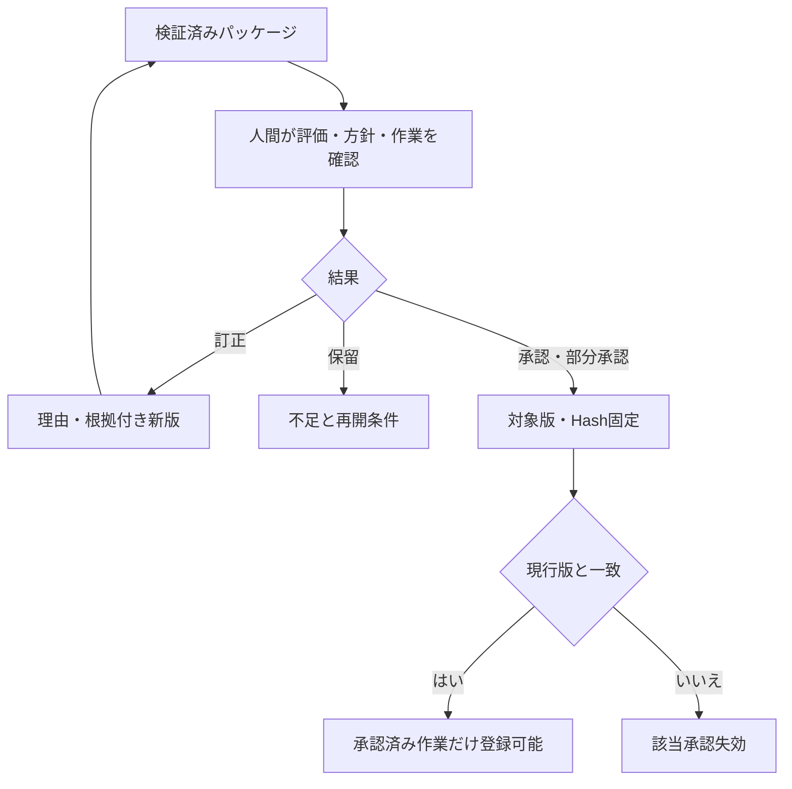
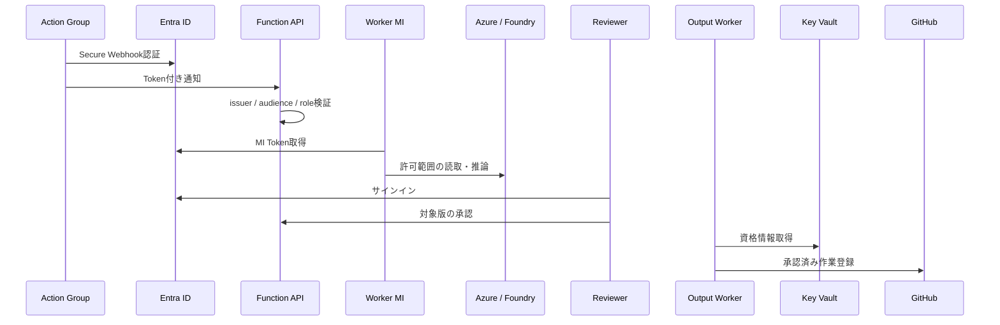
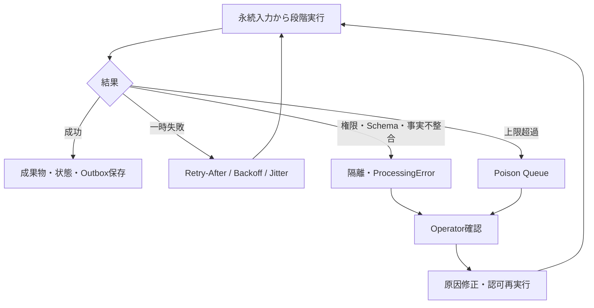
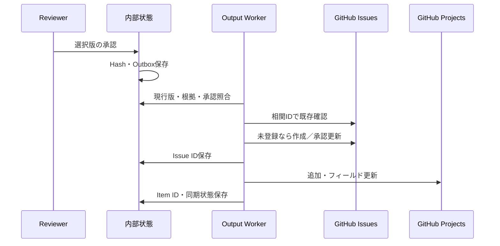

# システム設計書

版: 0.3 / 更新日: 2026-10-24 / 状態: 設計・開発用指示整備、アプリ実装前

会話で採用された方針をまとめる。数値閾値はPoC用であり、企業一般の標準や実測値ではない。詳細な基準は[判断・承認基準](decision-policy.md)、企業別フロー設定は[ワークフロー設定基準](workflow-configuration.md)、検証条件は[Spike・テスト計画](spike-and-testing.md)、最新の開発・CI/CD・認証・撤去方針は[開発・運用基準](engineering.md)を参照する。

## 1. Executive Summary

Azureの非推奨化・新規作成停止・サポート終了・リタイアメントを検知し、公式の対象情報と自社の実構成・業務情報を関連付け、影響度・優先度・開始時期・必要作業を提示する。人間が評価・方針・作業を承認し、選択した作業だけをGitHubへ登録する。

Microsoft-Decision-1を第一選択とする。生成LLMは説明と作業案を作るが、事実、期限、Resource ID、承認を確定しない。

## 2. Problem Statement

通知や公式推奨だけでは、自社の重要業務、体制、変更禁止期間、代替策を踏まえた対応判断が完結しない。更新漏れ、対象情報の反映遅延、根拠のない説明、チケット増殖を防ぎながら、判断を追跡可能にする。

## 3. Goals

- G-01: 発表と更新を取りこぼしなく管理し、取得範囲の限界も表示する。
- G-02: 対象の確度と業務影響を分けて評価する。
- G-03: 対応時期・作業・担当候補を根拠付きで提示する。
- G-04: 判断・説明・作業・承認からEvidenceへ追跡できる。
- G-05: 情報変更に応じて再評価し、必要な承認を取り直す。

## 4. Non-Goals

- OOS-001: インシデント対応・原因調査・復旧。
- OOS-002: 評価対象リソースの変更、移行、削除。本システム専用環境の承認済み手動CDは対象内。
- OOS-003: Microsoftの標準影響判定、Azure Policy、CMDBそのものの再実装。
- OOS-004: PoCでのデータプレーン、ゲストOS、SDK、コード、接続文字列の探索。
- OOS-005: 人間承認なしの最終確定、全Azureの網羅性保証。

## 5. Scope

同一Entraテナント、Azure Public Cloud、1 MG、最大5 Subscription、最大3サービス。既存Subscriptionの専用Resource Groupに評価システムを配置する。評価対象への読取権限は配置先権限と分離する。

3事例はBasic Load Balancer、Storage GPv1、Application Insights URL ping tests。過去・保存・合成データによる再現と現環境への接続試験を分ける。旧サービスの新規作成や新規環境へのRetirement通知発生を前提としない。

### 対象となるライフサイクル変更

**非推奨（Deprecation）となる機能・サービスもPoCから評価対象に含む。** Service HealthのHealth Advisoryを受け、Retirementサブタイプの有無だけで捨てず、通知メタデータ、公式本文・参照からライフサイクル変更への関連を選別する。無関係な一般案内は理由付き対象外、判別不能は分類レビューへ送る。障害・復旧・一般的なセキュリティ対応へスコープを拡張しない。

非推奨化、作成制限、サポート終了、廃止は別の意味とし、同じ通知で複数の変更を表せる。非推奨通知が必ず独立の公式サブタイプで配信されるとは仮定しない。Activity LogとARGで異なる項目名・値はソース別に正規化し、原値を保持する。ActionRequired／Informationalという値だけで対象・対象外を確定しない。実際の配送フィルターとPayloadはSP-02／03で確認する。

| 通知 | 挙動 |
|---|---|
| 非推奨＋明示された廃止期限 | 適用対象・期限・必要工程から通常評価 |
| 非推奨のみ・廃止期限未発表 | 対象・代替・制約を評価。廃止日はnull。要確認の対応は原則暫定P2＋人間レビュー |
| 新規作成停止 | 既存利用停止とみなさず、増設・再構築・DRへの影響を確認 |
| サポート終了 | 機能停止と分け、サポート・契約・運用上の影響を確認 |
| 関連性・意味不明 | 分類保留と人間確認。移行必須やNo actionを自動確定しない |
| 無関係な一般案内 | 対象外理由を記録し、移行作業や暫定P2を一律生成しない |

Advisorがない非推奨も評価する。Retirement向けのTracking ID関連付けがすべての非推奨へ使えるとは仮定せず、Service Health明示対象、承認済みARG条件、人間確認を利用する。制御プレーンだけで確認できない利用実態は既存のVerification Requiredとして扱い、PoCのデータプレーン除外を維持する。

将来はAzure Updates等の情報源、複数MG／テナント、CMDB、承認済み利用実態情報、ServiceNow等をアダプター追加で対応する。

## 6. Existing Service Boundary

| サービス | 標準責務 | 独自責務 |
|---|---|---|
| Service Health | 発表、Tracking ID、通知更新、提供される対象情報 | イベント履歴、管理対象との関連、再評価 |
| Advisor | Retirement recommendation、対象、公式移行案内 | 業務影響・優先度・体制判断 |
| ARG／ARM | インベントリ、公式情報の関連付け、構成読取 | Scope・鮮度・完全性、承認済み条件による候補探索 |
| Azure Policy | 準拠評価・統制 | 結果利用、Policy／IaC更新作業案 |
| SRE Agent | 既存運用支援との重複確認 | 必須構成にしない。今回の判断・承認は本システム |
| Foundry | 推論基盤 | 入力制御、評価、検証、承認 |

Advisor Workbookと重複する公式情報のみの画面を中心にせず、業務判断、不足情報、承認に重点を置く。

## 7. Stakeholders

ガバナンス責任者が方針・例外・合否を承認する。Workload Ownerが業務情報と最終レポート・対応方針を承認する。Cloud／SREは収集と運用、専門エンジニアは移行条件・期間、AI担当はモデル評価、Securityは権限と送信範囲、GitHub管理者は外部連携を担当する。Owner不明時はガバナンス責任者が暫定レビューする。

## 8. Assumptions

| ID | 前提 |
|---|---|
| A-01 | PoCは閉域・国内リージョン限定を必須としない |
| A-02 | 必要な読取権限を設定できる。過去データの存在は別途確認 |
| A-03 | 存在・SKU・Region等の技術事実は実環境を正本とする |
| A-04 | Owner、重要度、RTO/RPO、廃止予定は環境だけで断定せず人間管理 |
| A-05 | 日次再照合＋手動評価。業務上の処理・承認期限SLAは未設定 |
| A-06 | 営業時間運用。PoC終了時に関連リソース・実データ・資格情報を削除する |
| A-07 | システム自体の暫定RTOは8営業時間、RPOは24時間 |
| A-08 | A-07は通常障害の目標。地域全損保証ではなく、対象Workloadへ転用しない |

## 9. Open Questions

管理対象ID、Project等のID、利用リージョン・モデル提供条件、実Payload、評価ラベル、全社／Workload許容値、移行期間・予備期間、本番保持・DR・品質閾値は未確定。[合意・未決事項](decisions.md)で追跡する。Shadowから実登録・本番へ移る詳細ゲートも未確定である。

## 10. Functional Requirements

| ID | 要件 |
|---|---|
| FR-001 | 通知原文を保存し、共通形式へ正規化する |
| FR-002 | 新規・重複・更新・撤回・遅延旧版を区別する |
| FR-003 | Tracking ID、非推奨・作成停止・サポート終了・廃止の各公式日付、適用範囲、参照の版を管理する |
| FR-004 | Service Health／Advisor明示対象と条件一致候補を取得する |
| FR-005 | 6分類、独立した確認状態、取得完全性を保持する |
| FR-006 | Workload集約、共有所属、業務属性の出典・矛盾を扱う |
| FR-007 | 未対応時／対応時・対応後の影響、優先度、開始区分等を判断する |
| FR-008 | 指定10項目の説明と根拠付き構造化作業案を作る |
| FR-009 | ID・日付・根拠・所属・依存関係を検証する |
| FR-010 | 部分承認、差戻し、保留、版に対する承認を提供する |
| FR-011 | 承認済み作業だけをGitHubへ冪等登録・更新する |
| FR-012 | 構成・公式情報・業務情報・進捗変更を再評価する |
| FR-013 | モデル停止時は事実・ルール結果と手動評価へ切り替える |
| FR-014 | Health Advisoryから非推奨を含むライフサイクル変更を選別し、原分類・関連性・除外理由を保存する |
| FR-015 | 期限未発表・複数期限・作成制限を区別し、適用可能な作業期限だけで計画余裕を算定する |
| FR-016 | 非推奨から廃止期限発表への更新を再評価し、変更影響のある承認のみ失効させる |
| FR-017 | 調査結果「該当リソースなし」「対象外のみ」「調査不完全」「判定不能」を調査範囲・取得完了とともに区別する |
| FR-018 | 6分類ごとに理由、不足属性、Evidenceを保持し、リソース単位の結果を表示する |
| FR-019 | 作業候補の生成・集約・担当・順序・承認条件を設定可能にし、根拠と設定版を記録する |
| FR-020 | 評価レビューと作業確定・外部登録の承認を別々に管理し、定型結果だけ評価レビューを省略可能にする |

## 11. Non-Functional Requirements

| ID | 要件 |
|---|---|
| NFR-001 | 5 Subscription、1,000リソース、100イベント版で負荷を測る |
| NFR-002 | 再送・順序逆転・部分失敗・処理再開を扱う |
| NFR-003 | Schema、アダプター、モデル・ルールの版を分離する |
| NFR-004 | 同一の意味入力では不要な再推論を避ける |
| SEC-001 | Entra ID、Managed Identity、最小権限を基本にする |
| SEC-002 | 対象Azureへの書込権限とモデルの実行権限を与えない |
| SEC-003 | 送信属性・接続先を制限し、秘密・不要個人情報を除去する |
| DATA-001 | 原本、Snapshot、業務属性、判断、説明を別に版管理する |
| DATA-002 | 全事実に情報源・取得日時・適用範囲を持たせる |
| INT-001 | ソース共通契約と出力契約、外部ID対応を定義する |
| INT-002 | 登録前に承認Hashと現行版を確認する |
| AUD-001 | 入力、原出力、Model／Deployment／Prompt／Rule／Schema版を保存する |
| AUD-002 | 訂正・承認は理由・主体・時刻付き追記履歴にする |
| OPS-001 | Retry、隔離、再実行、復旧、手動運用のRunbookを用意する |
| OPS-002 | 原本と監査を通常ログのサンプリング対象にしない |
| OPS-003 | PoC終了時の関連リソース・実データ・資格情報の削除を台帳で管理する |
| SEC-009 | EOL・サポート終了済みランタイム・依存を新規採用・リリースしない |
| SEC-010 | 全依存の既知脆弱性検査を必須とし、不適合・検査不能でリリースしない |
| OPS-005 | 継続監査、EOL確認、更新と既存環境の暫定対策を管理する |

## 12. Proposed Architecture

Functions Flex Consumption（Always Readyなし）、評価用と出力用の2 Function Apps、ホスト用と業務用のStorage、Foundry、Key Vault、Application Insights／Log Analyticsを基本候補とする。React画面もAzureへ配置し、Entra認証とAPI認可を必須とする。配信サービスと対応リージョン・認証・課金はSpikeで確認する。TypeScriptモノレポ、Bicep、GitHub Actions CI＋手動CDを採用し、詳細はengineering.mdを正本とする。

複数テナント化はテナント別Collector・Identityを追加し、中央に全権限を集中させない。PoCではtenantIdとScope契約の確保まで。

## 13. Component Responsibilities

| サービス | 採用理由／代替 | PoC | 本番 |
|---|---|---|---|
| Action Groups | 標準通知。代替は定期取得補完 | 採用 | 推奨 |
| Logic Apps | 複雑なSaaS承認。代替Functions | 不採用 | 任意 |
| Functions | 処理・API。代替Container Apps等 | 採用 | 同等機能必須 |
| Service Bus | 高度配送時。代替Storage Queue | 不採用 | 規模次第 |
| Storage Queue | 小規模非同期処理 | 採用 | 適合時継続 |
| ARG / Advisor API | 標準情報。ARM個別取得は補完 | 採用／必要時 | 必要 |
| Foundry / Decision-1 | 推論・型付き判断 | 原則必須 | 第一選択 |
| 生成LLM | 説明・作業案。代替固定テンプレート | 採用 | 推奨 |
| SQL / Cosmos DB | 複雑検索・整合性・分散。代替Table | 不採用 | 再評価 |
| Blob / Table | 不変証跡・低コスト状態 | 採用 | 要件次第で継続 |
| Key Vault | 秘密管理 | 採用 | 必須機能 |
| App Insights / Log Analytics | 追跡・監視。既存OTel等で代替可 | 採用 | 必須機能 |
| API Management | API統制。代替Entra保護API | 不採用 | 必要時 |
| Entra / Managed Identity | 認証・Azure間接続 | 採用 | 基本方針 |
| Workbooks / Power BI | 運用・横断可視化 | 最小／不採用 | 任意 |
| Teams | 通知。画面等で代替 | 不採用 | 任意 |
| ServiceNow / Azure DevOps | 将来出力アダプター | 不採用 | 任意 |
| GitHub Issues / Projects | 作業正本と一覧 | 採用 | Org＋GitHub Apps |

## 14. End-to-End Workflow

日数経過、禁止期間、モデル・ルール更新も再評価契機。旧版到着で巻き戻さず、撤回は削除でなく変更提案とする。

## 15. Data Model

全体共通にtenantId、schemaVersion、createdAt、classification、出典と観測日時を持つ。論理モデルはIDで正規化し、不変JSONをBlob、状態・索引・OutboxをTableに保存。大きな本文はTableへ詰め込まない。

H1＝PoC実施中に保持し終了時に削除、H2＝現行状態と終了時までの履歴。旧90日保持方針は撤回。GitHub・CI等の外部複製も対象とし、サービス側の削除待ち等は残存として報告する。コード・設計・非実データの試験資材はGitへ残す。分類は原則機密。公開公式文書は公開分類、Subscription固有通知は社内分類以上とする。

| Entity／目的 | 主キー・主要属性・関係 | 更新契機 | 保持・情報源 |
|---|---|---|---|
| RetirementEvent／非推奨等も含む論理発表 | eventId、sourceKey、currentVersionId | 新規・状態変更 | H2／通知 |
| RetirementEventVersion／履歴 | eventVersionId、eventId、feature、lifecycleKinds、classificationStatus、milestones、Hash、refs | 本文更新 | H1／公式 |
| OfficialReference／公式版 | referenceVersionId、URL、Hash、原本、取得時刻 | 取得・更新 | H1／Microsoft |
| ResourceImpact／対象評価 | impactId、runId、snapshotId、分類、確認状態、根拠 | 評価 | H1／公式・探索 |
| Workload／業務単位 | workloadId、名称、状態、contextVersionId | 確認・更新 | H2／管理者・台帳 |
| WorkloadResourceMapping／所属 | mappingId、workloadId、resourceKey、有効期間、根拠 | 所属変更 | H2／構成・タグ・人間 |
| BusinessContext／業務版 | contextVersionId、重要度、Owner、RTO/RPO、禁止期間、属性別出典 | 更新・訂正 | H1／人間・台帳 |
| DecisionInput／固定入力 | inputId、runId、Snapshot参照、特徴量、欠損、Hash | 判断前 | H1／正本・計算 |
| DecisionResult／判断 | decisionId、inputId、回答・分布、棄権、ルール後結果、版 | 推論・ルール | H1／モデル・ルール |
| Explanation／主張群 | explanationId、decisionId、claims、10項目 | 生成・訂正 | H1／LLM・人間 |
| Evidence／根拠 | evidenceId、sourceVersionId、対象、位置、種別、Hash、時刻 | 取得・導出 | H1／各出典 |
| WorkItem／作業版 | workItemVersionId、logicalId、runId、属性・根拠・状態 | 生成・修正 | H1／公式・社内・AI |
| HumanReview／承認 | reviewId、packageHash、対象版、主体、結果、理由、scopeDisposition、reviewEvidenceIds | レビュー | H1／人間 |
| Feedback／訂正 | feedbackId、対象、旧新値、理由、根拠、有効期間 | 訂正・評価 | H1／人間 |
| AssessmentRun／実行 | runId、eventVersionId、scopeId、各版、状態、coverage | 実行・段階完了 | H1／基盤 |
| ProcessingError／失敗 | errorId、runId、stage、分類、試行、マスク詳細 | 失敗・復旧 | H1／基盤 |
| ResourceSnapshot／構成版 | snapshotId、resourceKey、存在、type、SKU、region、許可属性 | 読取 | H1／ARG・ARM |
| ScopeSnapshot／範囲 | scopeId、MG、期待・取得済Subscription、ページ完了 | 探索 | H1／Azure・設定 |
| PolicyProfile／基準 | policyVersionId、条件・閾値、承認、有効期間 | 方針更新 | H1／責任者 |
| WorkflowPolicy／企業別手順 | workflowPolicyVersionId、チーム規則、部署調整、作業依存、承認規則、適用条件、検証結果 | PR承認・適用 | H1／管理者・責任者 |
| ApprovalPackage／承認対象 | packageId、評価・作業版、Hash、検証結果 | レビュー準備 | H1／検証 |
| ExternalBinding／外部対応 | bindingId、logicalWorkItemId、Issue・Project Item ID、同期状態 | 登録・照合 | H2／GitHub |

### 正規化JSON Schemaの設計契約

Draft 2020-12を基本とする。ここでは実装コードでなく型契約を示す。内部参照のrefはID文字列であり、DB外部キーの検証はアプリ責務。

| 型 | 必須属性 |
|---|---|
| EventVersion | eventId:ref、source:string、sourceMetadata:object、feature:string、lifecycleKinds:enum[]、classificationStatus:enum、milestones:LifecycleMilestone[]、retirementDate:dateまたはnull、datePrecision:enum、deadlineStatus:enum、referenceIds:ref[]、contentHash:string |
| LifecycleMilestone | milestoneId:string、kind:enum、date:dateまたはnull、rawDateText:stringまたはnull、datePrecision:enum、scope:string、evidenceIds:ref[] |
| ResourceImpact | runId:ref、snapshotId:ref、impactClass:6分類enum、classificationReason:reason enum、missingAttributes:string[]、verificationStatus:enum、evidenceIds:ref[]、discoveryMethod:string、confidence:Confidence |
| DecisionAnswer | questionId:string、selectedOption:stringまたはnull、optionProbabilities:object、abstained:boolean |
| DecisionResult | inputId:ref、decisionStatus:enum、answers:DecisionAnswer[]、effectiveResult:object、ruleOverrides:array、versionManifest:object |
| Claim | claimId:string、text:string、claimType:enum、evidenceIds:ref[]、decisionRefs:ref[]、validationStatus:enum |
| Confidence | kind:enum、value:numberまたはnull、method:string、evidenceIds:ref[]、limitations:string[] |
| HumanReview | packageId:ref、packageHash:string、reviewerId:string、result:enum、reason:string、reviewedAt:date-time |

既存のRetirementEventという名称は非推奨等も含む共通ライフサイクルイベントの論理名として維持する。現状はSchema案のみで、既存データ移行はない。lifecycleKindsとmilestone.kindの内部候補はDeprecation／NewCreationBlocked／SupportEnded／Retirement／Unknown。これは本システムの分類であり、Microsoft公式APIのenumを新設・仮定するものではない。classificationStatusはInScope／OutOfScope／ReviewRequired。sourceMetadataには受信した種別・サブタイプ・タグ・incidentType等の原値を保持する。

Health Advisoryのソース分類と、人間の対象判定は分離する。`humanContext.scopeDisposition`はInScope／OutOfScope／ReviewRequiredとし、訂正理由をHuman Evidenceとして`reviewEvidenceIds`で参照する。OutOfScopeは人間が根拠を記録した場合だけ成立し、公式イベント分類は変更しない。対象外の新版はworkItemsを空、effectivePriorityをnullにし、レビュー画面・API・Exporterで承認／登録を拒否する。定期再評価でも対象外を保持するが、公式イベントの新しい版は別途再評価する。キーワードだけで自動除外しない。

非推奨開始日、新規作成停止日、サポート終了日、廃止日を個別に保持し、対象SKU・Region・利用条件とEvidenceを結び付ける。月単位の公式日付はrawDateTextと精度を保存し、架空の日を補わない。retirementDateは公式廃止日が日単位で確認できるときだけ設定する。Service HealthではRetirement subtypeに限り、`ImpactMitigationTime`を優先する。構造化値がなければ、公式タイトル／本文の「will be retired on <日付>」等、廃止を日付へ直接結び付ける限定表現だけを解析する。単なる移行・切替期限、他のイベントSubtype、複数候補または構造化値と文章の日付矛盾は自動採用せず、日付を未確認のまま人間確認へ送る。正規化ルール版の変更は、新しい不変EventVersionを作り、公式Source Content Hashとは分けて管理する。

DecisionInputとWorkItemはapplicableMilestoneIdsとapplicableDeadline（dateまたはnull）、deadlineBasis（公式期限／社内計画／未定）を持ち、どの期限が当該作業に適用されるかを追跡する。非推奨開始日は過去というだけで期限超過扱いしない。通知の一般的なImpactMitigationTimeを一律に廃止日へ変換しない。複数日付から無条件に最小日を取らず、影響シナリオと必要工程を確認する。

共通はadditionalPropertiesを原則禁止し、拡張領域のみ許可。日時UTC、業務日程は業務Timezone、欠損nullと空集合を区別。確率は0〜1、合計と選択肢整合は意味検証。影響度は4値、判断不能は別状態。参照実在、日付比較、DAGはSchema外で検証する。モデル送信用は対応サブセットへ変換する。

## 16. Decision Model Design

詳細は[判断基準](decision-policy.md)。ルールは日数・集計・最低優先度・強制レビュー・日付検証を担当。Decision-1は2軸影響、優先度、開始区分、難易度、プロジェクト化、既知Team集合からの候補を担当。LLMは説明・構造化作業案、人間は最終決定を担当する。

Deterministicは構成・件数・日数・所属等、Human-maintainedは重要度・Owner・RTO/RPO・提供時間・廃止予定・体制等、Model-basedは影響・難易度等。構成だけから実到達性や冗長化の有効性を断定しない。

原判断とルール後判断を別保存。最大確率0.80未満または上位差0.20未満は暫定レビュー強調条件。閾値は未校正であり高確率でも承認省略不可。Decision-1停止時は事実・ルール・人間、LLM停止時は固定テンプレートへ。指定モデル利用不可時は自動置換せず代替再検討。

## 17. Explanation and Grounding Design

説明必須10項目：判定影響度、増大要因、軽減要因、開始時期根拠、不足情報、結論が変わる条件、公式事実、社内事実、モデル／ルール判断、人間確認事項。

主張をConfirmed Fact、Derived Fact、Model Decision、Assumption、Unknown、Recommendationへ分類する。FactはEvidence、Derivedは入力と導出Rule、Decisionは回答参照、Assumptionは仮定ID、Unknownは不足と影響、Recommendationは提案根拠を付ける。

引用の存在検証と、引用が主張を支持する意味検証を分離する。LLMの自己申告だけで合格にしない。説明はモデル内部の思考再現ではない。訂正は旧版・理由・出典を保持し、自動学習へ直結しない。

## 18. Resource Impact Discovery

| 分類 | 条件 |
|---|---|
| Confirmed | Advisor／Service Healthが当該時点で明示 |
| Probable | 公式適用条件と取得構成が一致 |
| Possible | 根拠ある依存関係による間接影響 |
| Verification Required | 制御プレーンだけでは利用実態を判別不可 |
| Not Impacted | 明示除外条件や確認構成から対象外を説明可能 |
| Unknown | 条件・範囲・属性が不足 |

Unknownには理由を保持する。対応プロファイルなし、プロファイル不一致、必要属性不足、評価前、旧データで未記録を区別する。必要属性不足はVerification Requiredとし、不足属性・人間が確認する内容を画面に示す。未知のSKUや条件不一致を除外と推定しない。既存保存データのreason欠損はLegacyUnrecordedへ読み替え、別分類へ推測移行しない。Resourceのreason／不足属性はAssessment Hashへ含み、旧版の承認Hashは新Schemaで一致しなくなるため、旧承認を引き継がず再レビューする。

別にverificationStatusを持つ。空の公式対象一覧は対象外の証拠にしない。公式対象情報は遅延・変更し得る。対象削除、権限不足、反映遅延を区別。ARG apiVersionをアプリ使用APIの証拠にしない。Service Health impacted-resource IDからTracking IDを完全一致で抽出し、部分文字列一致による誤関連を避ける。Retirementに限るAdvisor関連付けは公式メタデータのTracking ID→recommendationTypeIdを結び、recommendationStatusがNew／InProgress／Postponedの推奨だけを明示対象候補とする。platformState等のシステム状態フィールドに依存しない。どちらかの取得に失敗しても他方の成功結果を保持し、Scopeを不完全として人間レビューへ送る。任意LLM生成KQLは実行せず、公式根拠とレビュー付き探索プロファイルを使う。

## 19. Work Item Generation

必須キー：Work Item ID、Category、Title、Description、Target Workload、Target Resource IDs、Owner Team、Required／Recommended、Priority、Planned Start Date、Due Date、Prerequisites、Completion Criteria、Human Approval Required、Evidence、Source Type、Official Reference、Dependency Work Item IDs、Status、Confidence。

未確定でもキーは保持しnullと理由を付ける。IDはシステム付与、LLMは許可別名を選択。公式・社内標準・AI提案を区別。公式参照がない社内作業は理由を明示する。Confidenceは出所を明示し、LLM自己評価を校正済確率としない。

カテゴリ：Impact Verification、Owner Confirmation、Migration Assessment、Architecture Design、Proof of Concept、Application Change、Infrastructure Change、Network Change、Security Review、Test、Change Management、Production Migration、Validation、Rollback Preparation、Legacy Resource Removal、Documentation Update、CMDB Update、Policy and IaC Update。

Unknown／Possible／Verification Requiredと確認フラグ付きConfirmedは、分類理由・不足属性・Evidenceから決定的なImpact Verification作業へ変換する。生成LLMの利用不可時も確認対象を失わない。作業はRecommendedかつ人間承認必須であり、移行必須・本番変更を意味しない。根拠なしにUnknownを対象外へ変更しない。

作業は実行せず提案のみ。不確実な対象には確認作業を作る。論理作業IDを維持し再評価で版更新する。

## 20. Validation and Guardrails

VAL-001: Resource IDは当該RunのARG／ARM／公式明示対象Snapshotに存在。VAL-002: Workload所属実在。VAL-003: 期限・適用範囲が公式版と整合。VAL-004: 後継と作業の引用支持。VAL-005: Planned Start ≤ Dueを検証し、適用可能な明示期限がある作業ではDue < applicableDeadline。廃止日だけに一律比較しない。VAL-006: DAG・前提日程整合。VAL-007: Criticalと不確実性は強制レビュー。VAL-008: Unknown等の自動クローズ禁止。VAL-009: 最新版・承認Hash照合。VAL-010: 取得欠落を影響なしにしない。

期限未発表はnullを維持し、調査・方針確認は人間承認の日程を設定可能とするが、公式廃止日前の完了検証済みとは表示しない。超過・完了不能は適用期限のある場合の例外として是正方針を人間判断。過去日を捏造して制約を通さない。構文修正再生成は1回までとし、事実不適合は黙って修正しない。

## 21. Security Architecture

人間はEntra RoleでReader／Reviewer／Governance／Operatorを分離。Collectorは許可ScopeのReaderを開始点とし必要操作を検証。Storageデータ権限、Foundry推論権限、Key Vault秘密読取を用途別に付与し、出力Workerには対象Azure読取や変更権限を与えない。

Action Group Secure Webhook→Entra保護受付を候補とする。対応可否はSpikeで検証し、Preview機能を必須にしない。Managed IdentityもService Principalを伴うため「SP完全排除」とはしない。

Foundryには必要な公式抜粋、許可構成、別名ID、許可業務属性だけを送る。秘密、接続文字列、不要個人情報、Properties全文は送らない。

| 脅威 | 対策 |
|---|---|
| 偽・改ざん通知 | 認証、公式再取得、Hash・経路保存 |
| 文書内Injection | 公式・社内文書も非信頼入力、命令権限なし |
| 過剰取得・昇格 | Scope明示、読取／出力分離、書込権限なし |
| 架空ID・誤登録 | 許可集合、根拠・承認Hash、専用Worker |
| 大量チケット | 相関ID、Outbox、上限・異常停止 |
| 期限誤認・古い台帳 | 適用範囲、精度、出典競合、鮮度確認 |
| SSRF | 許可ドメイン、DNS/IP・リダイレクト再確認、Metadata／Private宛禁止 |
| 外部漏えい | 非公開、マスク、詳細根拠は認証付き参照 |

本番ではOrganization App、Installation Token、対象Repository限定を基本とする。個人Project用資格情報はPoC限定。App秘密鍵等が残る場合はKey Vaultとローテーションで管理する。本番化時にPrivate Endpoint、所在地、外部送信規程を再審査する。

## 22. Failure Handling

原本とReceipt永続化後に受信成功を返す。Queue投入失敗はOutbox再走査で回復。同一イベントはETagと期限付きリース。QueueはID参照のみ。一時失敗は原則5試行、429は待機指示を優先。403・未対応Schemaは無限Retryしない。

外部Issue作成後の応答喪失は`Sending`状態で相関マーカーを検索し、見つかれば`IssueCreated`へ回復する。未発見または検索不完全ならIssueを再作成せず保留する。Exactly Onceを保証とはしない。Project追加だけ失敗した場合は保存済みIssue IDから再開し、Issue再作成をしない。障害中も公式ポータルと保存入力から手動評価できるRunbookを用意する。

## 23. Observability

eventId／runId／workloadId／workItemId／correlationIdで追跡。受信・重複・取得Scope・ページ完了・Unknown・モデル時間/Token/棄権・承認滞留・外部成否・Poison・費用を観測する。業務期限SLAは置かず、処理失敗・不正認証・費用異常は通知する。

ARG残クォータ・Reset・ページングを扱い、固定クォータを仮定しない。無変更再推論、長文、再生成、同時実行、ログ量を制限。Azure予算通知だけを厳密な支出停止としない。保存・監査費用は推論停止後も残る。

## 24. Testing Strategy

[テスト計画](spike-and-testing.md)に詳細。Unit、Integration、Contract、Schema、Rule、Model、Grounding、Security、Failure Injection、Idempotency、Performance、UAT、Shadowを実施。合成データによる成功と実接続成功を分離する。

## 25. PoC Scope

M0実現性→M1認証・保存・監査→M2受信・探索→M3判断・説明・検証→M4承認・GitHub→M5再評価・障害・Shadow。成果物は設計、契約、根拠付き一覧、レポート、レビュー、外部連携、評価報告、Runbook、登壇デモ。

過去計画の期間8〜12週、60〜90人日は粗い概算で、人件費をクラウド予算に含めない。実測・事例取得後に再見積もりする。Decision-1不可、実例不足、予算超過、越権・無承認登録等は[Spike判断](spike-and-testing.md)に従い縮退・停止・再検討。

## 26. Implementation Backlog

S=1〜2人日、M=3〜5、L=6〜10。依存完了後の並行可否。合計は確定見積もりではない。

| ID / Epic | Title・内容 | 依存 | 成果物／受入 | リスク | 規模／Role／並行 |
|---|---|---|---|---|---|
| T-01 Spike | モデル・認証・型契約 | なし | 実呼出、分布、版保存 | 提供条件 | M／AI・Cloud／Yes |
| T-02 Spike | 通知・ARG・事例 | なし | Payload、対象、正解候補 | データ不足 | M／Cloud・SME／Yes |
| T-03 Spike | 個人GitHub権限 | なし | Issue・Project操作 | 認証制約 | S／Integration／Yes |
| T-04 Foundation | 要件・Schema・基準版 | T-01〜03 | 契約・未決ゲート | 基準不足 | M／Architect／No |
| T-05 Foundation | Identity・保存・監査 | T-04 | 最小権限接続 | 過剰権限 | M／Cloud・Security／Yes |
| T-06 Ingestion | 受信・永続Receipt | T-05 | 保存後応答・再送 | 欠落 | M／Backend／Yes |
| T-07 Normalization | 更新・重複・撤回 | T-06 | 旧版巻戻しなし | 日付誤認 | M／Backend／Yes |
| T-08 Discovery | 公式・条件・coverage | T-07 | 6分類と部分失敗 | 対象漏れ | L／Cloud・SME／Yes |
| T-09 Context | Workload・タグ・矛盾 | T-04,05 | 出典・共有所属 | 情報欠損 | M／Backend・Owner／Yes |
| T-10 Decision | 特徴量・モデル・ルール | T-01,08,09 | 原判断と最終候補 | 過小評価 | M／AI・Backend／No |
| T-11 Explanation | 説明・作業生成 | T-10 | 10項目・根拠 | 幻覚 | M／AI／Yes |
| T-12 Validation | ID・日付・根拠・DAG | T-11 | 不正出力排除 | 意味検証 | M／Backend・QA／Yes |
| T-13 Review | 訂正・部分承認・Hash | T-12 | 版承認・失効 | 誤承認 | M／Full Stack／Yes |
| T-14 Integration | Issue・Project・照合 | T-03,13 | 承認済のみ・冪等 | 重複 | M／Integration／Yes |
| T-15 Observability | 費用・監視・再実行 | T-05,06 | 上限・追跡 | ログ費 | M／SRE／Yes |
| T-16 Reassessment | 差分・進捗・失効 | T-08〜14 | 無変更再推論なし | 競合 | M／Backend／Yes |
| T-17 Security | 脅威試験・強化 | T-12〜14 | 越権・SSRF等阻止 | 見逃し | M／Security／Yes |
| T-18 Evaluation | 品質・障害・負荷 | T-02,10〜17 | 指標・未評価報告 | 正解不足 | L／QA・SME／Yes |
| T-19 Readiness | Shadow・復旧・判定 | T-18 | 合否・残課題 | 早期本番化 | M／Architect・SRE／No |
| D-01 Demo | 実データとAzure上の3分ライブ画面 | T-12,13 | Entra認証・ライブ処理・状態確認 | 時間超過・実対象不足 | M／Full Stack／Yes |
| D-02 Demo | 台本・動画・公開確認 | D-01 | 3回リハーサル | 情報露出 | S／登壇者／Yes |

## 27. Risks and Mitigations

公式対象遅延→再照合とcoverage。古い業務情報→属性別正本とレビュー。確率過信→校正と棄権。説明後付け→主張支持検証。外部成否不明→照合・保留。Table整合性→不変Blob・ETag・Outbox。将来過剰設計→契約のみ先行。モデル廃止→Version固定と変更評価。費用→差分・利用制限。外部保存残留→削除台帳。

## 28. Decision Log

採用済みと未決を[合意・未決事項](decisions.md)に記録する。個人GitHubはPoC／デモ限定、本番はOrganization＋GitHub Appsである。

## 29. Acceptance Criteria

AC-001: 100回再送でも版・作業・Issueが増殖しない。AC-002: 通知から根拠・対象へ追跡可能。AC-003: 空結果を対象外にしない。AC-004: 取得欠落を明示。AC-005: 2軸判断・確率・ルール理由保存。AC-006: 主張・作業に根拠。AC-007: 架空ID・不正日付・DAG・無承認の外部通過0。AC-008: 訂正・部分承認・失効。AC-009: 外部成否不明を隔離。AC-010: Unknownと外部Closeだけで自動完了しない。AC-011: モデル停止時に手動評価。AC-012: Azure変更権限なし。AC-013: 復旧・再実行試験。AC-014: 品質・費用・未評価を報告。AC-015: 非Retirement分類の非推奨も選別し、未発表日付の補完・移行断定をしない。AC-016: 作成停止・サポート終了・廃止の適用範囲を分け、期限更新で再評価・再承認する。

## 30. Recommended Next Steps

ルートAGENTS.mdと3 Skillsを整備。次はモノレポ・CI／IaC／手動CDの最小基盤を実装し、Spikeを実行する。Azure作成は対象ID・資格情報・課金条件と実行範囲を確認後に行う。Shadowから登録・本番へ移る段階ゲートは引き続き決める。

## 公式参照

機能・期限は再確認が必要。サンプルの値を顧客環境の実測値と扱わない。

- [Service Healthの種別・サブタイプ・タグ](https://learn.microsoft.com/en-us/azure/service-health/service-health-event-tags)
- [Service Health通知のデータ項目](https://learn.microsoft.com/en-us/azure/service-health/service-health-event-properties)
- [Service HealthとAdvisorの関連付け](https://learn.microsoft.com/en-us/azure/service-health/service-retirement-unified-impact-queries)
- [Advisor ARG推奨状態](https://learn.microsoft.com/en-us/azure/advisor/advisor-azure-resource-graph)
- [Health Advisory影響対象・反映遅延](https://learn.microsoft.com/en-us/azure/service-health/impacted-resources-retirements)
- [Advisor Workbook](https://learn.microsoft.com/en-us/azure/advisor/advisor-workbook-service-retirement)
- [Decision-1](https://learn.microsoft.com/en-us/azure/foundry/foundry-models/how-to/use-foundry-models-microsoft-decision)
- [ARG概要](https://learn.microsoft.com/en-us/azure/governance/resource-graph/overview)
- [ARGクォータ](https://learn.microsoft.com/en-us/azure/governance/resource-graph/concepts/guidance-for-throttled-requests)
- [Action Groups認証](https://learn.microsoft.com/en-us/azure/azure-monitor/alerts/action-groups)
- [Functions接続](https://learn.microsoft.com/en-us/azure/azure-functions/manage-connections)
- [Queue失敗処理](https://learn.microsoft.com/en-us/azure/azure-functions/functions-bindings-storage-queue-trigger)
- [Table設計](https://learn.microsoft.com/en-us/azure/storage/tables/table-storage-design)
- [構造化出力](https://learn.microsoft.com/en-us/azure/foundry/openai/how-to/structured-outputs)
- [GitHub Projects API](https://docs.github.com/en/issues/planning-and-tracking-with-projects/automating-your-project/using-the-api-to-manage-projects)
